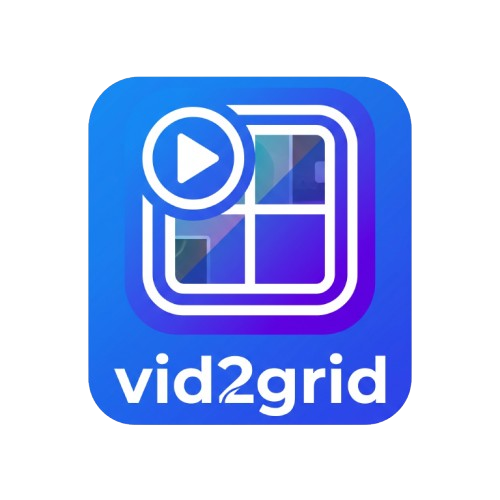
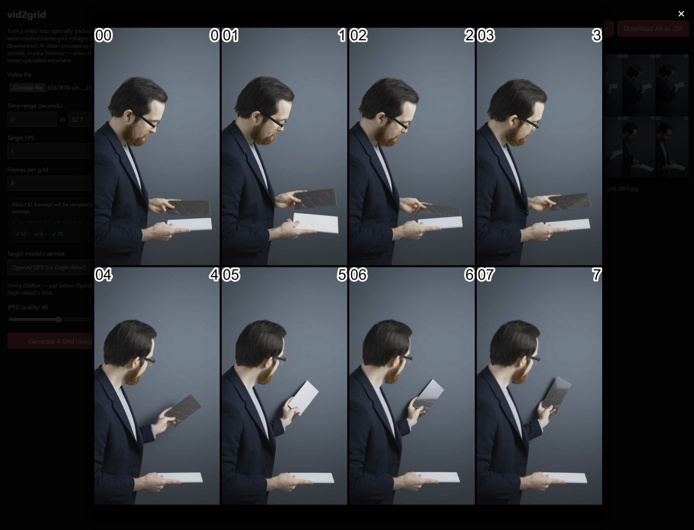
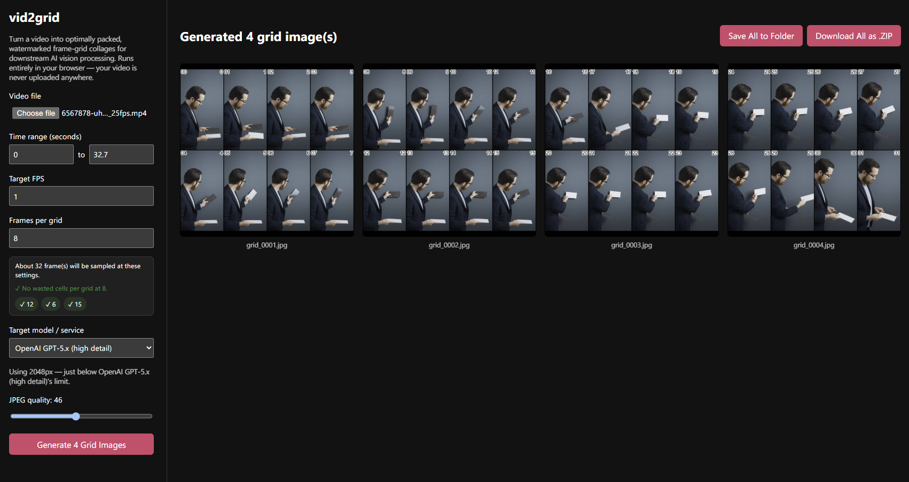

<p align="center">
  <br>
  <a href="https://github.com/IanHeinrich/vid2grid/actions/workflows/pages.yml"></a>
</p>

vid2grid turns a video into **collage sheets**: square grid images that pack
many timestamped frames into one JPEG. They are sized for AI vision models
(OpenAI, Gemini, Claude, Grok, Venice.ai), so you send a few sheets instead of
hundreds of separate frames. Every cell carries its timestamp and frame index,
and the grid layout makes each frame as large as the sheet allows.

<p align="center">
  
</p>

## Ways to use vid2grid

| Way                                         | For                                     | Install or run                                                                                                                  | Folder                                      |
| ------------------------------------------- | --------------------------------------- | ------------------------------------------------------------------------------------------------------------------------------- | ------------------------------------------- |
| [Website](#website)                         | Anyone, no install                      | Open [ianheinrich.github.io/vid2grid](https://ianheinrich.github.io/vid2grid/)                                                  | [apps/web](apps/web/)                       |
| [Python library](#python-library)           | Python code                             | `pip install "git+https://github.com/IanHeinrich/vid2grid#subdirectory=apps/python-library"`                                    | [apps/python-library](apps/python-library/) |
| [Python command line](#python-command-line) | Shell scripts and one-off runs          | `uvx --from "git+https://github.com/IanHeinrich/vid2grid#subdirectory=apps/python-cli" vid2grid clip.mp4`                       | [apps/python-cli](apps/python-cli/)         |
| [MCP server](#mcp-server)                   | AI agents such as Claude Code           | `claude mcp add vid2grid -- uvx --from "git+https://github.com/IanHeinrich/vid2grid#subdirectory=apps/mcp-server" vid2grid-mcp` | [apps/mcp-server](apps/mcp-server/)         |
| [Node library](#node-library)               | Node.js code, from a checkout           | `npm run build --workspace apps/node-library`                                                                                   | [apps/node-library](apps/node-library/)     |
| [Node command line](#node-command-line)     | A shell without Python, from a checkout | `node apps/node-cli/dist/cli.js clip.mp4 -o sheets`                                                                             | [apps/node-cli](apps/node-cli/)             |

Every way runs the same planner, so the same video and options give the same
sheets: same grid, same timestamps, same file names. The options come from one
spec too, so each has the same flag on both command lines and the same name in
the MCP tools. Transcripts are available on the website and, with the
`transcribe` extra, from the Python library, command line and MCP server. The
Node packages do not transcribe.

None of the packages is on PyPI or npm yet. The Python ones install straight
from this repository; the Node ones run from a clone.

## Website

**[ianheinrich.github.io/vid2grid](https://ianheinrich.github.io/vid2grid/)**

Drop in a video, pick a time range, a sampling rate and a target model, and
download the sheets as a `.zip`. Everything runs in your browser and the video
is never uploaded. A model quick-select sets the sheet size just below each
vision model's image limit, Keyframe fast mode gives a near-instant preview,
and an optional in-browser Whisper model writes WebVTT transcripts beside the
sheets.



To run it locally, from the repo root:

```bash
npm ci
npm run dev
```

More in [apps/web/README.md](apps/web/README.md).

## Python library

```bash
pip install "git+https://github.com/IanHeinrich/vid2grid#subdirectory=apps/python-library"
```

```python
from vid2grid import render_from_options

result = render_from_options("clip.mp4", "sheets", {"targetFps": 2, "framesPerGrid": 16})
for sheet in result.sheets:
    print(sheet.path, sheet.first_timestamp_seconds, sheet.last_timestamp_seconds)
```

PyAV decodes and Pillow paints. Add the `transcribe` extra for transcripts with
faster-whisper. More in
[apps/python-library/README.md](apps/python-library/README.md).

## Python command line

Run it without installing:

```bash
uvx --from "git+https://github.com/IanHeinrich/vid2grid#subdirectory=apps/python-cli" vid2grid clip.mp4 -o sheets
```

Or install the `vid2grid` command:

```bash
pip install "git+https://github.com/IanHeinrich/vid2grid#subdirectory=apps/python-cli"
vid2grid clip.mp4 --fps 2 --frames-per-grid 16 -o sheets
```

`vid2grid --help` lists the options. More in
[apps/python-cli/README.md](apps/python-cli/README.md).

## MCP server

Gives an agent two tools: `video_to_sheets` renders sheets from a local video,
and `plan_video` returns the plan without rendering. To add it to Claude Code:

```bash
claude mcp add vid2grid -- uvx --from "git+https://github.com/IanHeinrich/vid2grid#subdirectory=apps/mcp-server" vid2grid-mcp
```

Any MCP client that launches a stdio server takes the same command. More in
[apps/mcp-server/README.md](apps/mcp-server/README.md).

## Node library

Private and not on npm, so it runs from a clone. From the repo root:

```bash
npm ci
npm run build --workspace apps/node-library
```

```ts
import { renderVideo } from "@vid2grid/node";

const { sheetPaths } = await renderVideo(
  "clip.mp4",
  {
    startSeconds: 0,
    endSeconds: 30,
    targetFps: 1,
    framesPerGrid: 16,
    outputResolution: 1024,
    jpegQuality: 85,
  },
  "sheets",
);
```

It brings its own ffmpeg, ffprobe and canvas from npm. More in
[apps/node-library/README.md](apps/node-library/README.md).

## Node command line

From the repo root, build the library first, because the command line loads
it at run time:

```bash
npm ci
npm run build --workspace apps/node-library --workspace apps/node-cli
node apps/node-cli/dist/cli.js clip.mp4 -o sheets
```

More in [apps/node-cli/README.md](apps/node-cli/README.md).

## How it works

One planner, in [packages/core](packages/core/), decides everything about a
sheet: which moments to capture, where each frame sits, what text is burned
in and what each file is called. It writes that down as a `RenderPlan`, plain
JSON specified in [docs/render-plan.md](docs/render-plan.md). Each runtime
then has an executor that only decodes, scales, pastes, draws text and
encodes as the plan says: [packages/browser](packages/browser/) for the
website, ffmpeg and a Skia canvas for Node, PyAV and Pillow for Python. The
Python library runs core's own code in an embedded V8 rather than a port of
it, which is why its sheets match. Sheets from different executors match in
geometry and text, not in bytes, because each rasterises text its own way.

[docs/architecture.md](docs/architecture.md) explains the design, and
[docs/adding-a-host.md](docs/adding-a-host.md) shows how to add an executor
for another runtime.

## Contributing

Bug reports, ideas and pull requests are welcome. See
[CONTRIBUTING.md](CONTRIBUTING.md) for the workflow and what a change needs
before it merges.
